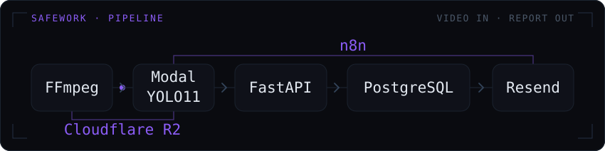

  

I build backend systems at the intersection of public services, automation, and applied AI.

At STC/MA, I develop digital workflows for public transparency. At SafeWork, I lead the development of a computer-vision platform for workplace safety. In both, I work across the full lifecycle, from requirements to deployment.

**Currently** — full-stack developer at the **Maranhão State Transparency Office (STC/MA)** · founder of **SafeWork** 
**Languages** — Portuguese (native) · English (C1) · French (A2)

Sobre mim (PT-BR)

 

Desenvolvo sistemas que unem backend, automação e IA aplicada.

Na STC/MA, desenvolvo fluxos digitais para transparência pública. Na SafeWork, lidero o desenvolvimento de uma plataforma de visão computacional para segurança do trabalho. Nos dois contextos, atuo em todo o ciclo, dos requisitos à implantação.

**Atualmente** — desenvolvedor full-stack na **Secretaria de Transparência e Controle do Maranhão (STC/MA)** · fundador da **SafeWork** 
**Idiomas** — português (nativo) · inglês (C1) · francês (A2)

## Selected work

**Agiliza Transparência** — *Maranhão State Transparency Office (STC/MA), with Oxygeni Hub (CEUMA)* · `closed source` 
Full-stack developer on the platform that replaces a manual, spreadsheet-and-paperwork transparency data collection process between the Office and more than 60 state bodies. I modelled the data structure and the access control (three user profiles, institutional single sign-on) and built the full-stack foundation: routes, pages and domain tests. The Office opens a collection cycle from a semantic catalogue and distributes it to the state's managing units, each with its own deadline and extensions; submissions are checked structurally on upload, optionally reviewed by a focal point before they arrive, and every change lands in an append-only audit trail. Laravel 13 with Inertia and React 19, tested with Pest, Vitest and Playwright, including automated accessibility checks (axe).

Ver em português

 

**Agiliza Transparência** — *Secretaria de Transparência e Controle do Maranhão (STC/MA), com o Oxygeni Hub (CEUMA)* · `código fechado` 
Desenvolvedor full-stack da plataforma que substitui um processo manual, baseado em planilhas e documentos, de coleta de dados de transparência entre a Secretaria e mais de 60 órgãos do Estado. Modelei a estrutura de dados e o controle de acesso (três perfis de usuário, login único institucional) e construí a fundação full-stack: rotas, páginas e testes de domínio. A Secretaria abre um ciclo de coleta a partir de um catálogo semântico e o distribui às unidades gestoras do Estado, cada uma com seu prazo e possíveis prorrogações; os envios são verificados estruturalmente, podem passar pela revisão de um ponto focal e toda alteração é registrada em uma trilha de auditoria na qual os registros não são sobrescritos. Laravel 13 com Inertia e React 19, testado com Pest, Vitest e Playwright, inclusive com verificação automática de acessibilidade (axe).

  

**SafeWork** — *founder* · `closed source` 
As founder and project lead, I built the backend of the platform that analyses CCTV footage exported from a client's recorder, detects missing PPE, and turns detections into a workplace-safety compliance report; my co-founder developed the detection model. Detection runs in batches on serverless GPU, and a missing helmet is a rule derived over the person, head and helmet classes rather than a class of its own — so nobody is flagged just because the model failed to see a hat. PPE detection is the first product; the platform is being built to expand into other workplace-safety products.

Ver em português

 

**SafeWork** — *fundador* · `código fechado` 
Como fundador e líder do projeto, construí o backend da plataforma que analisa imagens de CCTV exportadas do gravador do cliente, identifica EPIs ausentes e transforma as detecções em um relatório de conformidade em segurança do trabalho; o co-fundador desenvolveu o modelo de detecção. A detecção roda em lotes com GPU serverless, e a ausência de capacete é uma regra derivada das classes pessoa, cabeça e capacete — não uma classe isolada. A detecção de EPIs é o primeiro produto; a plataforma está sendo construída para expandir para outras soluções de segurança do trabalho.

  

**WhatsApp Ombudsman Chatbot** — *Public Prosecutor's Office (MP/MA)* · `closed source` 
I designed and built this end-to-end first-line intake for the ombudsman channel on the official WhatsApp Cloud API. A deterministic state machine walks the citizen through consent under Brazil's data protection law, one of three modes — identified, confidential or anonymous — field-by-field validated data collection, a free-text report with attachments, and a review-and-edit pass before anything is submitted. Redis holds session state with a three-hour expiry, message deduplication and a distributed lock, so concurrent messages cannot corrupt a conversation.

Ver em português

 

**Chatbot da Ouvidoria via WhatsApp** — *Ministério Público do Maranhão (MP/MA)* · `código fechado` 
Projetei e construí de ponta a ponta este primeiro atendimento da Ouvidoria sobre a API oficial do WhatsApp Cloud. Uma máquina de estados determinística conduz o cidadão pelo consentimento da LGPD, pela escolha entre atendimento identificado, sigiloso ou anônimo, pela coleta validada dos dados, pelo relato com anexos e por uma etapa de revisão e edição antes do envio. O Redis mantém o estado da sessão por três horas, faz a deduplicação das mensagens e aplica um lock distribuído para impedir que mensagens concorrentes corrompam a conversa.

  

## Public projects

| Project | What it is | Stack |
|---|---|---|
| [**Orders analyst with AI**](https://github.com/EnzoFrazao/analista-pedidos-ia) | Portuguese-language agent that answers business questions about a restaurant's orders with read-only SQL behind five safety layers, evaluated on the project's own 25 questions, with a Streamlit panel. Synthetic data, demo only. [Live panel](https://pedidoai.streamlit.app/) | Python, SQLite, Streamlit, tool calling |
| [**KaizenDo · GUARÁ**](https://github.com/EnzoFrazao/KaizenDo) | Real-time positioning of rail-yard crews for Vale's KaizenDO challenge: ESP32 + GPS tags report to a Raspberry Pi, and the app recommends who reaches each work front fastest. [Demo video](https://github.com/EnzoFrazao/KaizenDo#demonstra%C3%A7%C3%A3o) | TypeScript, Next.js, ESP32, Raspberry Pi |
| [**Vértice Consultoria**](https://github.com/EnzoFrazao/vertice-consultoria) | Landing page plus demo client and admin portals for a real-estate consultancy, in an npm-workspaces monorepo with the foundation of a Laravel API | TypeScript, React, Laravel |
| [**Email triage with AI**](https://github.com/EnzoFrazao/triagem-emails-n8n-ia) | n8n workflow that classifies incoming email with LLaMA 3.3 (structured JSON output), logs it to Google Sheets and replies in the right tone | n8n, Groq, Gmail and Sheets APIs |
| [**Construction diary (mobile)**](https://github.com/EnzoFrazao/undb-mobile) | Daily site reports with photos and three roles (owner, site manager, client); owner sign-off locks the report and keeps prior versions | React Native, Expo, Node.js |
| [**ADS coursework**](https://github.com/EnzoFrazao/ads-2-semestre) | Semester track from Python and web fundamentals to a 13-screen mobile banking prototype | Python, JavaScript, React, TypeScript |
| [**Java fundamentals**](https://github.com/EnzoFrazao/java-fundamentos) | My 2024 Java learning path in one place, from syntax to small OOP console systems | Java |

Ver em português

 

| Projeto | O que é |
|---|---|
| [**Analista de pedidos com IA**](https://github.com/EnzoFrazao/analista-pedidos-ia) | Agente em português que responde perguntas de negócio sobre os pedidos de um restaurante com SQL somente leitura em cinco camadas de segurança, avaliado nas 25 perguntas do próprio projeto, com painel Streamlit. Dados sintéticos, só demonstração. [Painel no ar](https://pedidoai.streamlit.app/) |
| [**KaizenDo · GUARÁ**](https://github.com/EnzoFrazao/KaizenDo) | Posicionamento em tempo real das equipes do pátio ferroviário, para o desafio KaizenDO da Vale: etiquetas ESP32 + GPS enviam a posição a um Raspberry Pi, e o sistema recomenda quem chega mais rápido a cada frente. [Vídeo da demonstração](https://github.com/EnzoFrazao/KaizenDo#demonstra%C3%A7%C3%A3o) |
| [**Vértice Consultoria**](https://github.com/EnzoFrazao/vertice-consultoria) | Landing page e portais demonstrativos de cliente e de administração para uma consultoria imobiliária, num monorepo com npm workspaces e a fundação de uma API Laravel |
| [**Triagem de e-mails com IA**](https://github.com/EnzoFrazao/triagem-emails-n8n-ia) | Workflow n8n que classifica e-mails com LLaMA 3.3 (saída em JSON estruturado), registra em planilha e responde no tom certo |
| [**Diário de obra (mobile)**](https://github.com/EnzoFrazao/undb-mobile) | Relatórios diários de obra com fotos e três perfis (dono, responsável, cliente). A assinatura do dono bloqueia a edição e preserva as versões anteriores |
| [**Entregas de ADS**](https://github.com/EnzoFrazao/ads-2-semestre) | Trilha do semestre, dos fundamentos de Python e web até um protótipo de banco digital com 13 telas |
| [**Fundamentos de Java**](https://github.com/EnzoFrazao/java-fundamentos) | Minha trilha de estudos de Java de 2024 num só lugar, da sintaxe a pequenos sistemas de console com POO |

## Let's talk

  
  

